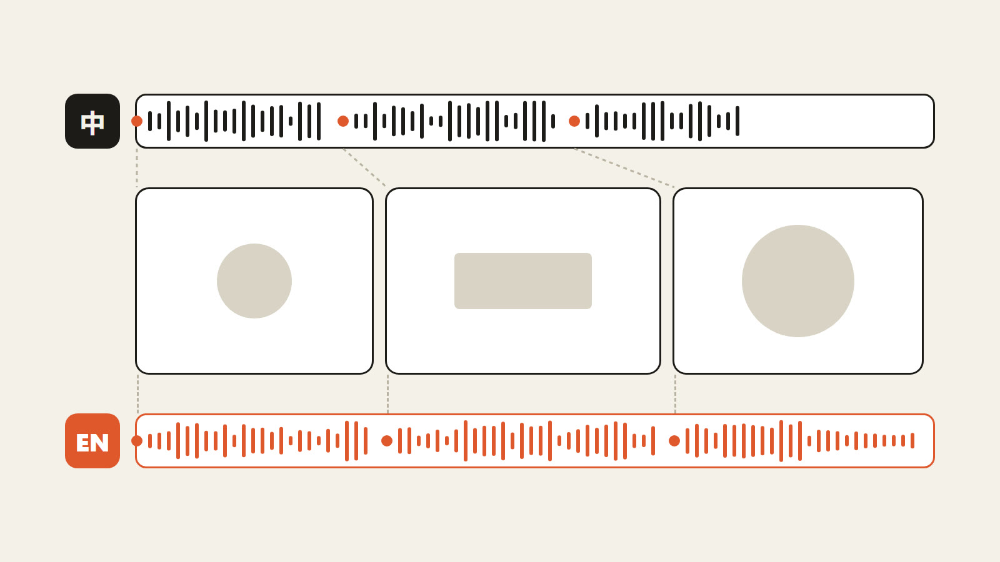

# dub

An [OpenFilm](https://github.com/openfilm/openfilm) skill: the same film in another language. The voice-over is
translated for the ear and spoken again, the text in the pictures is translated, and the pictures are retimed so each
still lands on the word it was made for. Studio makes the new subtitles from the new voice.

| | | |
| --- | --- | --- |
|  | [Another language](skills/dub) | Your voiced film in another language: voice-over said again, text and subtitles translated, every picture still on its word. |

Studio can already translate a film's subtitles. That leaves the original voice under them, and every number or key
word that lands on a spoken word lands on the wrong one once the new language says it at another moment. This skill
is for when the film has to be heard in the new language.

What the brief asks of the agent:

- each line keeps its meaning, facts, numbers and names; lines changed to work in the new language (a pun, a local
  example) are named, with why;
- lines written to the length a native script would have, in a voice like the original's; where a line needs more
  time the pictures make room, and the voice is never sped up;
- every picture tied to a word lands on it in the new voice within two frames, measured from the new voice-over's word
  times, and the furthest one is reported;
- text in pages and titles translated and checked in the frames for fit; text inside footage that cannot change is
  listed;
- the new language in a copy of the project, the original untouched;
- before voicing every line on a paid service, the agent says how many lines and characters it will be.

## Use it

- **In OpenFilm**: open Skills, add one from a link, and paste `https://github.com/WEBGRS/openfilm-dub`.
- **In your own agent** (Claude Code, Codex and others): `npx skills add WEBGRS/openfilm-dub`.

It needs a voice-over service connected in OpenFilm (Settings → Providers), with voices in the new language. A brief
only: no scripts, nothing installed.

## Check

```sh
node scripts/check.mjs
```

[evals/README.md](evals/README.md) has the requests it was tried on, with and without it, and what came of each.

## 中文说明

OpenFilm 技能：把配好音的片子做成另一种语言。旁白按新语言的说话习惯重写、重新配音，画面里的文字一起翻译，再调整画面时间，让每个画面仍然踩在它原本对应的词上。新字幕由 Studio 按新配音生成。

Studio 本来就能翻译字幕，但原声还在下面；而且新语言念到某个数字或关键词的时刻变了，原来踩在词上的画面就全错位了。这个技能是给「要让观众听到新语言」的情况用的。

需求书对智能体的要求：每句话的意思、事实、数字和名字不变，为了适合新语言改过的句子（双关、本地化的例子）要列出来并说明原因；句子按母语脚本的长度来写，用和原片相近的声音，需要更长的时间就让画面让位，不加速配音；每个踩词的画面在新配音里误差两帧以内，按新配音的逐词时间量，报出差得最多的一个；页面和标题里的文字翻译后逐帧检查是否放得下，素材里改不了的文字列出来；新语言做在项目副本里，原片不动；用付费服务配音前，先报要配几句、多少字。

**安装**：在 OpenFilm 的技能页点「添加 skill」，粘贴链接 `https://github.com/WEBGRS/openfilm-dub`；用自己的智能体就运行 `npx skills add WEBGRS/openfilm-dub`。需要先在 OpenFilm 的设置（左上角的 OpenFilm 标志）→ 服务商里连好一个配音服务，并且有新语言的音色。只有一份需求书，没有脚本。
